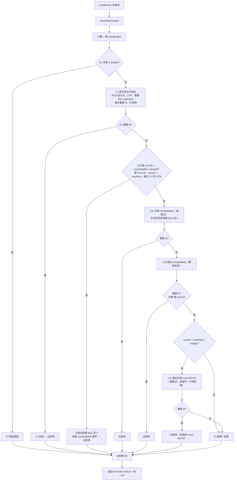

# Mnemo Token 预算与用量计量设计

> 版本：v1.0（草案，2026-10-08）  
> 日期：2026-10-08  
> 范围：方案设计（详细）+ 实现关键设计（不含具体实现代码）。供后续 Claude Code prompt 落地参考。

**读者画像**：了解 Mnemo 架构；熟悉 Node / Express / MongoDB / LLM 应用基本概念，但不了解 Token 预算管理内部设计。本文目标：把 Mnemo 如何在装配 LLM prompt 前做 token 预算裁剪、并产出用量计量（metering）的设计讲清楚，作为实现依据。

---

## TL;DR

- Mnemo 在 `chatStream` 装配 LLM prompt 之前，由 `ContextBudgeter` 按模型输入上限裁掉溢出内容，保证不超出上下文窗口。
- 预算模型把上下文拆成 system / STM / LTM / RAG 四块 + 自由池；LTM 是固定 ~7K 微小槽，真正会伸缩的是 STM 与 RAG。
- 降级分 L0–L3 四级：正常全放→逐出可选块（floor）→压缩/丢弃 competitable→临时压缩 must-fitSTM→硬墙报错；硬 must-fit（system + 用户消息 + 最近 3-5 轮 STM）不可丢弃，仅 system + 用户消息自身超预算才报错。
- token 计数在消息落库、记忆入库/更新、笔记父块重切分三处算一次并缓存，预算服务只读求和。
- 预算服务同时产出用量计量账单（bill，数据层），供 W3 计量埋点观测真实分布，软闸先行；可视化仪表盘为未来消费方，当前未构建。

---

## 0. 术语

- **Token 预算（Token Budget）**：在把上下文装配进 LLM prompt 前，按模型上下文上限裁掉溢出内容并保留核心信息的机制。
- **inputBudget**：单轮请求允许塞进模型输入侧的 token 上限，公式为 `maxContext − 输出预留 − 安全余量`。
- **must-fit（硬必装集）**：无论如何不能丢弃、不能永久截断的内容（system 提示 + 当前用户消息 + STM 最近 3–5 轮）；被静默截断会破坏对话语义。作为最后手段（L2c）可为本请求做临时抽取式压缩（非破坏、不改存储原文）。
- **competitable（可压缩集）**：STM 取最近 20 轮，除 must-fit 外的其余 ~15 轮；可被抽取式压缩，极端时整体丢弃。区别于 must-fit 在于它可被降级牺牲。
- **eviction（逐出）**：超预算时按优先级丢弃可选块（LTM / RAG）的过程。
- **用量计量（Metering）**：预算服务产出的用量账单（bill）数据层，记录各块实际用量、是否被裁、触发层级（L0–L3）、must-fit 是否被压缩；W3 先上计量埋点观测真实分布。这是当前设计真正要落的东西。
- **仪表盘（Dashboard）**：未来规划的可视化面板，消费计量账单做展示。当前未构建，仅是账单的潜在消费方。

---

## 1. 方案背景与目标

**TL;DR**：长上下文模型不等于可无限制塞内容；Mnemo 同时有笔记全文、长期记忆、会话历史多源，需要一层预算闸门。

Mnemo 的上下文由多源拼装：系统提示、会话历史（STM）、长期记忆（LTM）、笔记 RAG。模型虽有 1M 上下文，但单轮输入上限（991K）与输出预留（128K）之间才是可用空间。若不约束，超长笔记全文或长会话会直接撑爆输入窗口导致报错。

方案在 `chatStream.service.ts` 装配最终 prompt 之前插入预算服务，按优先级裁剪可选块、压缩历史，并产出**用量计量账单（metering bill，数据层）**。先在 W3 上线计量埋点观测真实分布，再据实测决定是否启用硬裁、是否构建可视化仪表盘——仪表盘是账单的未来消费方，当前未构建。

---

## 2. 根假设与预算公式

**TL;DR**：预算不等于模型最大上下文；inputBudget 由模型注册表配置化计算。

`inputBudget = maxContext − maxOutput − margin`。以 Qwen3.7-Plus 为例：上下文 1M、最大输入 991K、最大输出 128K，安全余量取约 5K，非思考模式 inputBudget ≈ 858K。

公式与模型规格必须配置化（放 `config.ts` 的模型注册表），因为不同模型上限不同，写死会随模型切换失效。maxOutput 必须预留，因为模型本轮还要生成最多 128K 输出，不能把输入也占满。

---

## 3. 预算四块模型

**TL;DR**：上下文拆成 system / STM / LTM / RAG 四块 + 自由池；LTM 是固定微小槽，真正伸缩的是 STM 与 RAG。

| 块     | 性质       | 控制     | 说明                                                    |
| ------ | ---------- | -------- | ------------------------------------------------------- |
| system | 半固定     | ≤10%     | 模板 + 写模式动态块；动态块超则截断                     |
| STM    | 真正伸缩   | ≤30%     | 会话历史；超则滚动摘要                                  |
| RAG    | 真正伸缩   | ≤25%     | 笔记父块召回；超则降 topK + 尾部截断                    |
| LTM    | 固定槽 ~7K | 非 ratio | 8×800 上限，按类别分级检索/注入侧防御截断（不入库截断） |
| 自由池 | 剩余       | —        | 当前用户消息 + 实际输出 + margin                        |

LTM 因 `8 条 × ≤800 token = 6400`（约 0.75% of 858K）属固定微小，从百分比系统剔除，退化为固定槽；其中 ≤800 是**检索/注入侧防御截断上限（非存储上限，库内存全量）**，仅作预算伸缩参考。自由池才是当前用户消息与真实输出的家。

---

## 4. must-fit 硬集

**TL;DR**：system + 当前用户消息 + 最近 3–5 轮 STM 为硬 must-fit，不可丢弃、不可永久截断；competitable（STM 其余 ~15 轮）可压缩可丢弃；仅 system + 用户消息自身超预算才报错。

must-fit 是降级链里的不可裁底线：system 固定不裁，当前用户消息必须保留（静默截断会丢用户原话），STM 中最近 3–5 轮是语义核心、绝不丢弃或永久截断。STM 取最近 20 轮，其中除 must-fit 外的轮次为 competitable（可抽取式压缩，极端可整体丢弃）；可选块（LTM / RAG）有 floor 软下限，超预算时先裁可选块，再压缩/丢弃 competitable，最后才动 must-fit。

must-fit 不可丢弃、不可永久截断，但作为最后手段（L2c）可为本请求做临时抽取式压缩（非破坏、不改存储原文）。仅当「system + 用户消息」自身已超出 inputBudget 时，请求才真正不可满足，预算服务报错/拒答；若 system + 用户消息放得下、只是 must-fitSTM 溢出，则临时压缩 must-fitSTM 而非报错。

---

## 5. 降级 4 级阶梯 L0–L3

**TL;DR**：L0 全量 fit 直接装配；L1 逐步逐出可选块（floor）；L2 在 D3=否 时按 competitable 压缩→丢弃→must-fitSTM 临时压缩 三级递进；仅 system + 用户消息超预算才 L3 报错。每步重算 fit 防御校验，确定性成功，冗余 D4 已删。

D3 判定对象为「硬 must-fit（system + 用户消息 + 最近 3–5 轮 STM）+ competitable」。D3=是：核心已放得下，可选块跌破 floor 至 0 后出账单，不压缩历史；D3=否：先 L2a 压缩 competitable、仍超则 L2b 整体丢弃 competitable，再超则判 system + 用户消息是否放得下——放得下走 L2c 临时压缩 must-fitSTM，放不下才 L3 报错。floor（top5/top4）是 L1 软下限，D3/L2 极端降级允许跌破至 0。

---

## 6. L1 逐出策略

**TL;DR**：先裁 RAG（floor 保 top5 父块）再裁 LTM（floor 保 top4 核心画像）；块内按各自原生分数从低砍，不跨块归一化。

RAG 体量大、可按需重检，LTM 微小且是产品核心记忆，故 RAG 先于 LTM 被裁。LTM 用检索返回的 `rrfScore`、RAG 用 `rrfFuse`（子块检索分归因召回的父块），各自块内排序。

不跨块归一化：块序淘汰已定（RAG 先、LTM 后），归一化只服务于「全局混排」，而全局混排已被否决，故无用途。floor（top5 / top4）是 L1 的软下限，确保常规降级核心内容不被裁；进入 D3/L2 极端降级时允许跌破至 0，因为可选块本就是 D2 超额来源。

---

## 7. L2 压缩与 competitable 降级

**TL;DR**：L2 在 D3=否时触发，按 competitable 压缩 → competitable 丢弃 → must-fitSTM 临时压缩 三级递进，均在可选块已跌破 floor 至 0 前提下；仅当 system + 用户消息自身超预算才落 L3。每步重算 fit 防御校验，确定性成功。

触发条件：L1 逐出可选块至 floor 仍超 → 进 D3。

- **D3=是**（硬 must-fit + competitable ≤ budget）：可选块跌破 floor 至 0，competitable 原样保留，直接出账单；不进入压缩。
- **D3=否**（硬 must-fit + competitable > budget）：可选块先跌破 floor 至 0，再走 L2 三步——
    - **L2a** 抽取式压缩 competitable（保最近轮完整、中间轮首尾截断）→ 重算 fit，fit 即出账单；
    - 仍超则 **L2b** 整体裁剪 competitable（置 0）→ 重算 fit，fit 即出账单（此时仅剩硬 must-fit）；
    - 仍超则判定 **system + 用户消息 ≤ budget ?**
        - 否（system + 用户消息自身超预算）→ **L3 报错**；
        - 是 → **L2c** 对本请求的 must-fitSTM 做临时抽取式压缩（非破坏、不改存储原文）→ 重算 fit，fit 即出账单（压缩后的 must-fitSTM + system + 用户消息）；仍超（压缩后仍放不下）→ **L3 报错**。

压缩均用抽取式（保留首尾 token、丢中间铺垫），不上 LLM 摘要。每步重算 fit 作防御校验；L2a/L2b 已验证地板故确定成功，L2c 仅在 system + 用户消息 ≤ budget 时启动，确保不会无意义压缩。

---

## 8. token 计数落库

**TL;DR**：计数在消息落库、记忆入库/更新、笔记父块重切分三处各算一次并缓存；预算服务只读求和，不每次重算。

- 消息：`chatStream.service.ts:395 persistConversation` 双写 STM（Redis）与 ChatMessage（Mongo）时，用 `tokenizer.ts:22 countTokens` 算 content 的 token 并两处都写。
- MemoryFact：入库（`ADD`）与更新（`UPDATE`）路径存**全量** content 并算 `tokenCount` 落库（`config.ts` 维护类别上限表，仅作检索/注入侧防御截断上限，**不在存储期截断**）。
- NoteChunk：仅父块重切分时算 `tokenCount`；子块不计算（RAG 召回父块注入，子块仅检索键）。

复用现有 `tokenizer.ts`（cl100k_base），对中文略高估 Qwen 真实用量，正好偏安全方向。

---

## 9. 写模式预算

**TL;DR**：写模式必须纳入预算；若笔记全文超过模型 maxToken，不报错，改为只提供光标邻域上下文 + 标题。

写模式上下文由 `writeContext` 预装配、绕过默认检索路径，但预装配是笔记全文，可能超长且无闸门，故写模式同样过 `ContextBudgeter`。

特殊处理：当全文长度超过模型单轮 maxToken 时，不整体报错，而是退化为「光标邻域（beforeText / afterText）+ 标题」注入，保证工具调用仍有锚点。这与 chat 模式「超预算报错」不同——写模式全文是用户主动编辑的文档，整体丢弃会破坏工具上下文。

---

## 10. 用量计量与埋点

**TL;DR**：预算服务产出账单（bill，数据层），记录各块用量、触发层级、压缩标记；W3 软闸先行，先看分布再定硬裁阈值。可视化仪表盘为未来消费方，当前未构建。

bill 结构包含：`inputBudget`、每块实际用量与是否被裁、触发层级（L0–L3）、must-fit 是否被压缩。未来若构建可视化仪表盘，将消费这份计量账单做展示（当前未构建）。

分期：软闸（观测 / 计数 + 账单）先上，硬裁（强制截断）二期。L2 / L3 触发频率是真实分布的关键观测信号——若频繁触发，说明默认 floor / 配额需要重新校准。

---

## 11. 实现设计（关键设计，不含代码）

### 11.1 类设计：ContextBudgeter

集中所有 token 处理逻辑为单一类 `ContextBudgeter`，各部件组装均调用其方法，不散落于多处：

- `constructor(model)`：按注册表算 `inputBudget`。
- `processSystemPrompt(parts)`：动态块超则截断。
- `processUserMessage(msg)`：must-fit，超则报错。
- `trimLtmFacts(scored, selectedIds)`：按 rrfScore 裁，floor 保 top4。
- `trimRagChunks(scored)`：按 rrfFuse 裁，floor 保 top5。
- `compressMustFit(rounds)`：L2 确定性压缩。
- `assembleContext(input)`：编排 L0–L3，返回裁好的 `finalMessages` + `systemPrompt` + `bill`。

### 11.2 数据库字段变更

三处 model（`types/models.d.ts`）各加 `tokenCount?: number`：

- `ChatMessage`（`:22`）：消息落库时写。
- `MemoryFact`（`:87`）：入库/更新时写。
- `NoteChunk`（`:117`）：仅父块重切分时写，子块不加。

### 11.3 模型注册表与 floor 常量（config.ts）

`config.ts` 增加 `MODEL_REGISTRY['qwen3.7-plus'] = { maxContext, maxInput, maxOutput, margin }` 与 `getInputBudget()`；新增 `BUDGET_CONFIG.ltmCategoryTokenCap`（类别**检索/注入侧防御截断**上限表，非存储截断）与 `BUDGET_FLOOR = { rag: 5, ltm: 4 }` 常量，便于统一维护。

### 11.4 集成点（chatStream.service.ts）

非写模式：在 LTM 注入（`:186`）与 RAG 注入（`:211`）之后、`createStreamChat`（`:224`）之前，把带瞬态分数的检索结果喂给 `assembleContext`，拿回裁好的 `finalMessages` / `systemPrompt` / `bill`。RAG 注入内部已有的 token 计算改为调用 `ContextBudgeter` 的 RAG 裁剪方法，裁完由 `buildSystemPrompt(base, trimmedLTM, trimmedRAG)` 拼串。`rrfScore` 不入库，由 `searchResult.results` 瞬态携带，不改 `select()` 合约。

### 11.5 测试策略

- counting：`countTokens` / `truncateByTokens` 中英文混合单测。
- eviction：greedy + floor 边界（RAG 先空才动 LTM；floor 不被破）。
- compression：确定性 + 地板边界（仅最近轮仍超→配合 D3 落 L3）。
- assembleContext：L0/L1/L2/L3 happy path + D3 地板边界。范式参考 `tests/evals/recall-selection.test.ts` + `golden.json`（describe.each + 精确断言）。
